# Alquimia · documentación del grupo

Actualizado el 19/10/2026.

## Plan de sprints

- [`sprints/sprints.pdf`](sprints/sprints.pdf): el plan completo, con cada tarea desplegada.
- [`sprints/sprints.html`](sprints/sprints.html): la misma página interactiva. Se descarga y se abre con el navegador.

## Boceto de pantallas

### 1 · Inicio y reglas
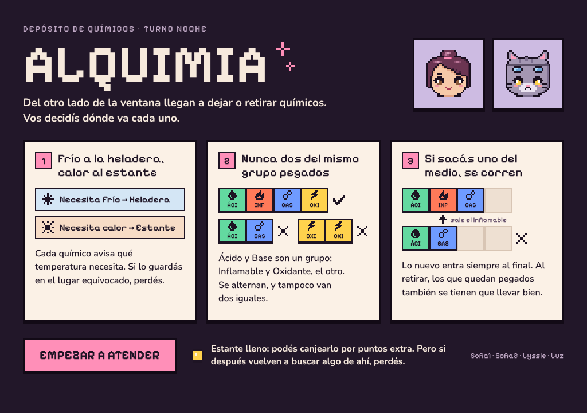

### 2 · Mostrador
Cuando el visitante viene a dejar un químico y cuando viene a retirarlo.

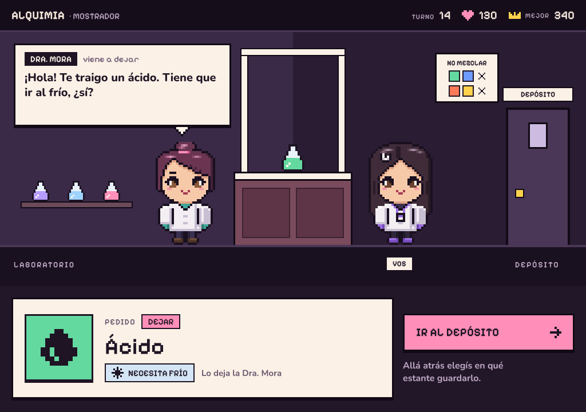
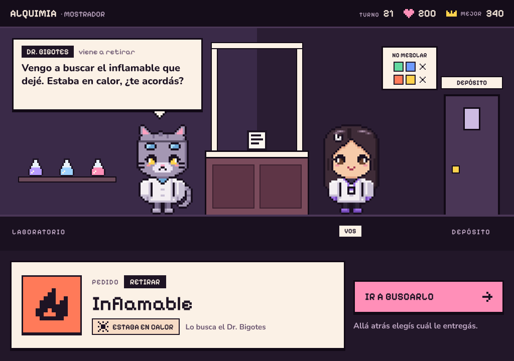

### 3 · Depósito
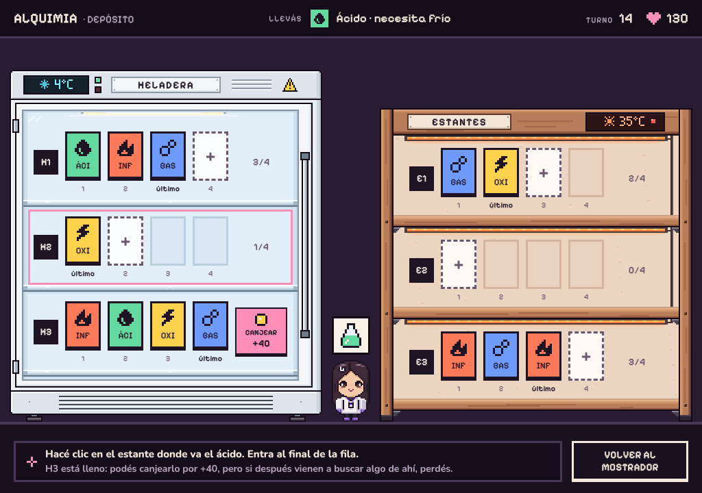
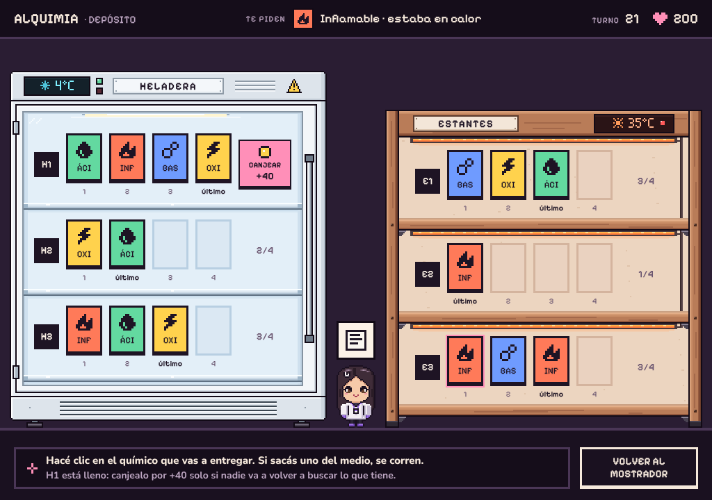

### 4 · Pantalla final
Una por cada forma de perder.

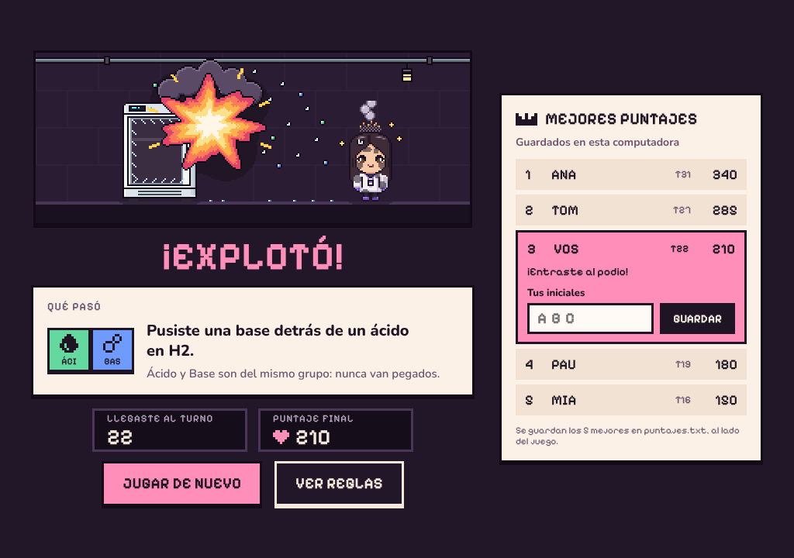
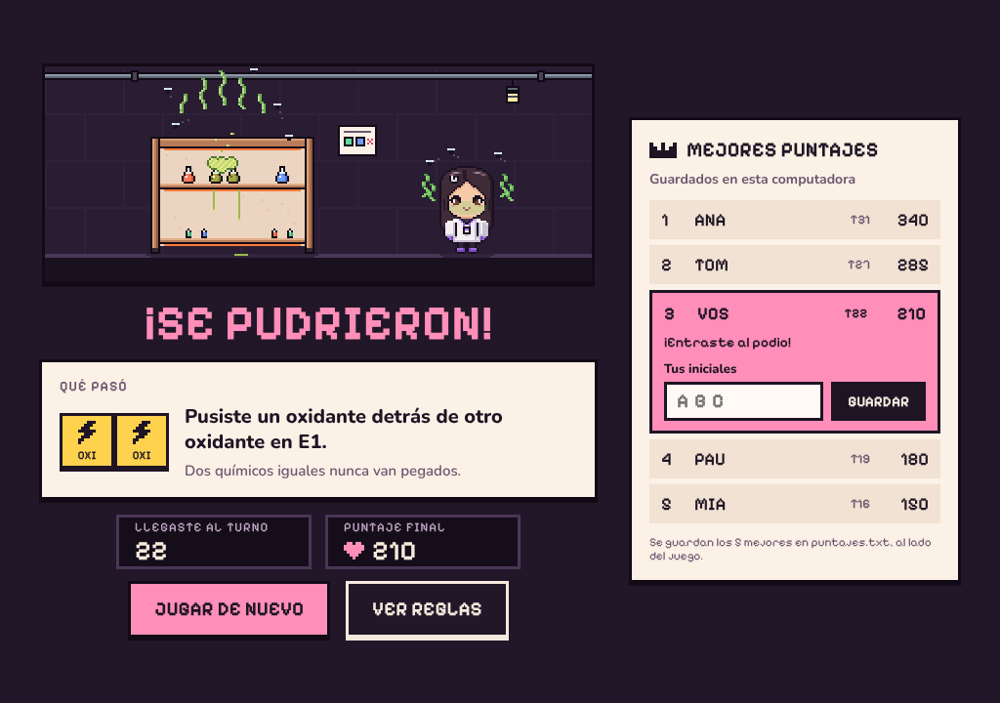
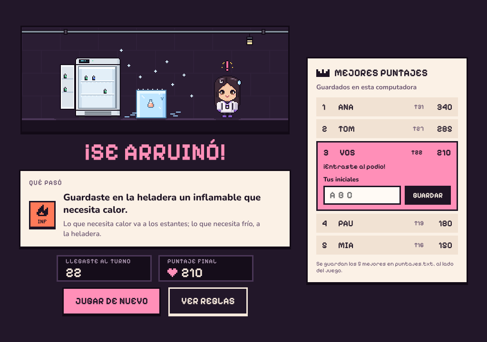
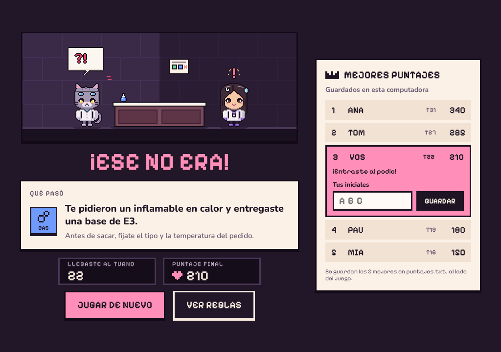
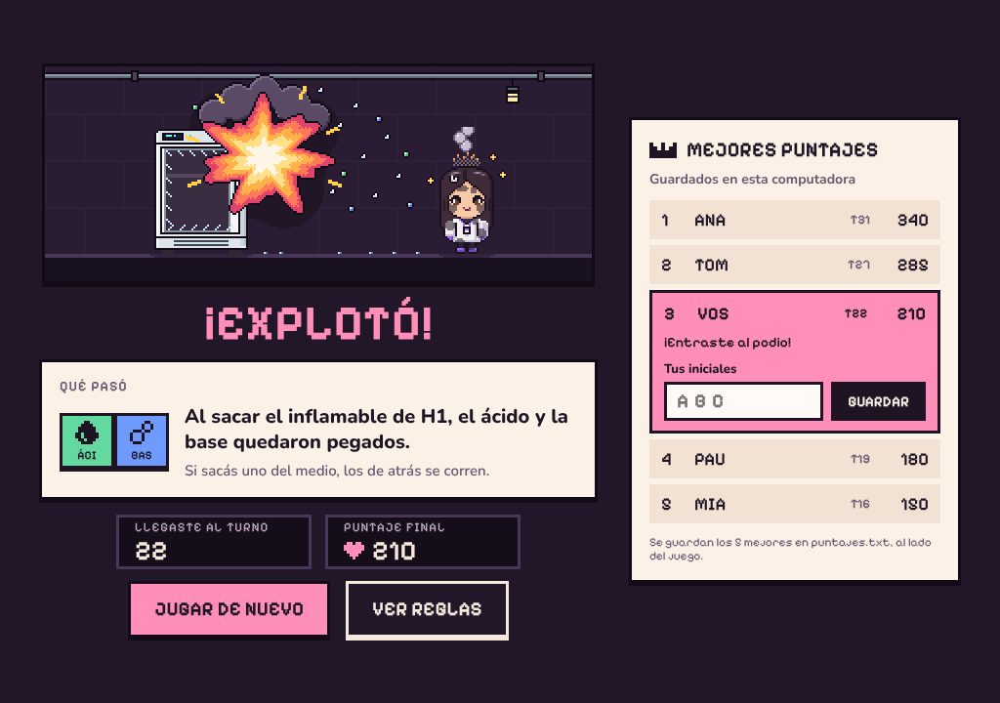
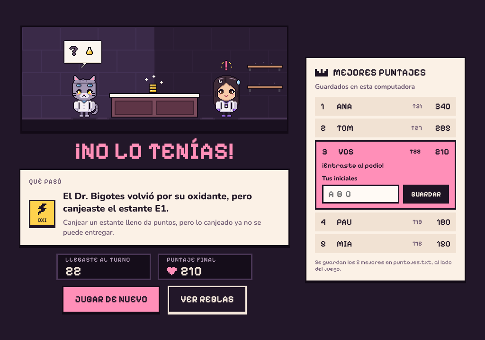

### Personajes y equipo
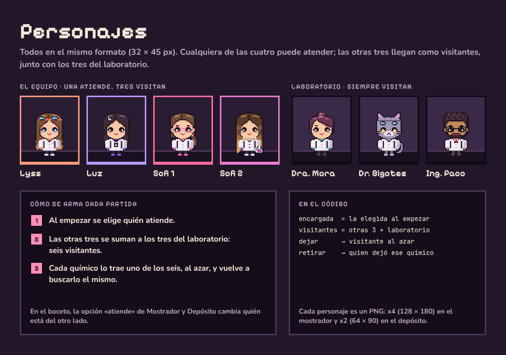
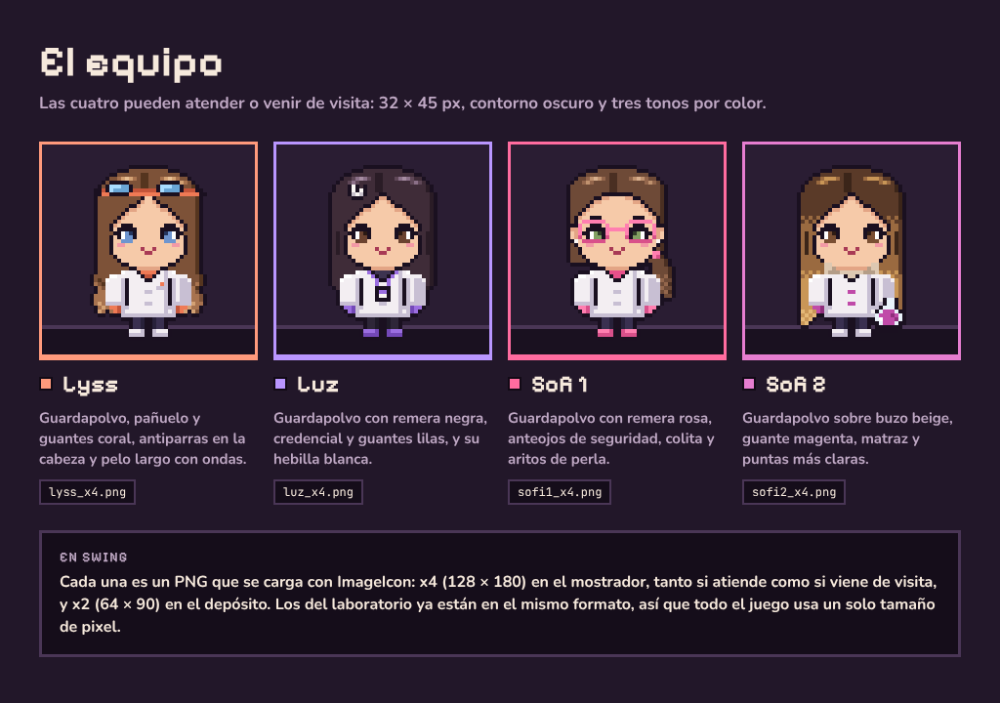

### Guía para armarlo en Swing
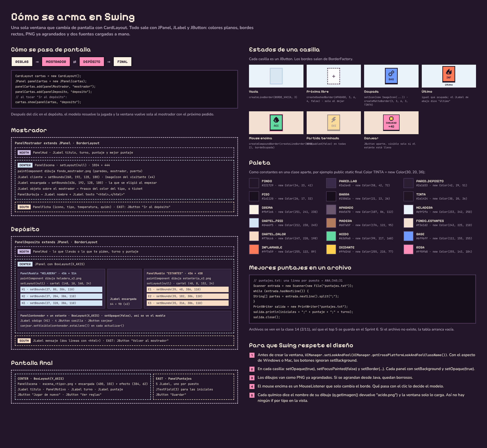
